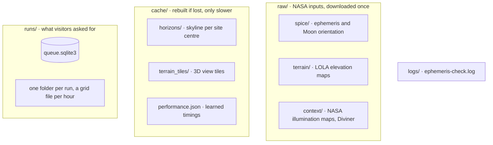

# Data layout

This folder holds the NASA inputs, the caches and the simulation outputs. Run `uv run lunascout-science fetch-data` from `backend/` to download everything that is missing. To keep the data elsewhere, set `LUNASCOUT_DATA_DIR`.

| Safe to delete? | Folder | Consequence |
|---|---|---|
| Yes, but it is re-downloaded | `raw/` | About 2 GB to fetch again |
| Yes | `cache/` | Skylines, tiles and timings are rebuilt. The next runs are slower and estimates are rough until it relearns |
| **No** | `runs/` | Deletes every saved simulation |

## What is in it

| Path | What | Source |
|---|---|---|
| `raw/spice/` | `naif0012.tls` (leap seconds), `moon_de440_250416.tf` and `moon_pa_de440_200625.bpc` (lunar orientation), `de440s.bsp` (positions of the Sun, Earth and Moon, 1849–2150) | NASA NAIF |
| `raw/terrain/LDEM_60S_240MPP_ADJ.TIF` | 240 m LOLA, 60°S–90°S: far-field horizon | NASA Goddard PGDA |
| `raw/terrain/LDEM_80S_80MPP_ADJ.TIF` | 80 m LOLA, used within about 120 km of a site | NASA Goddard PGDA |
| `raw/terrain/*_final_adj_5mpp_surf.tif` | 5 m LOLA for 10 candidate sites (below) | NASA Goddard PGDA |
| `raw/context/` | NASA's long-term illumination products (`AVGVISIB_*`, `LPSR_*`, `SKYV_*`, about 150 MB) and `diviner_prp_south.npz` (58 MB) | NASA Goddard PGDA, NASA PDS |
| `cache/horizons/` | Terrain skyline maps, one file per site centre, shared by every radius at that centre | computed |
| `cache/terrain_tiles/` | Elevation tiles served to the 3D view | computed |
| `cache/performance.json` | How long each stage took on this server, per CPU count, from the last 40 runs of each kind. Used for the time left | computed |
| `runs/queue.sqlite3` | The run queue and who wants each run | computed |
| `runs/<run id>/` | Per-hour result grids, site map, saved rays | computed |
| `logs/ephemeris-check.log` | One line per monthly check: the largest SPICE–Horizons difference | computed |

The ten 5 m sites are Connecting Ridge (`Site01`), Shackleton Rim (`Site04`), Nobile Rim 1 (`Site06`), Peak near Shackleton (`Site07`), de Gerlache Rim (`Site11`), Leibnitz Beta Plateau (`Site20`), Malapert Massif (`Site23`), Haworth, Shoemaker, and Nobile Rim 2 (`DM2`).

## Notes on the files

- **Why 5 m tiles are loaded only near a site.** Beyond 60 km an 80 m posting subtends less than 0.08°, against the Sun's 0.53°, while loading every 5 m tile would take more than 1 GB of memory.
- **Skyline cache keys.** A map is keyed by the terrain checksums, the receiver heights and the method revision, so changing any of them rebuilds it. Maps built before sites were labelled cannot be matched to a site and are never removed automatically.
- **Run folders share files.** When a run copies samples from an earlier run, the snapshot files are hard-linked, not duplicated, so overlapping runs cost almost no disk.
- **Diviner table.** `fetch-data` downloads NASA's 605 MB `dlre_prp_south.tab`, cuts it to a 58 MB file with each triangle's annual mean temperature (2 cm depth), annual maximum surface temperature and ice depth, and deletes the original. In the table `-999` means no ice is stable within 2.87 m; it also holds an undocumented `-1` in the coldest triangles, which LunaScout reads as ice stable at the surface.
- **Lifetime of results.** A custom site's results are removed when you delete it. A reference site's are hidden and kept 14 days. Results nobody has asked for in 14 days are cleaned up when the worker starts. See [Runs, reuse and the queue](../docs/runs.md).

## Where to read more

- How the numbers are produced: [docs/physics.md](../docs/physics.md)
- How runs, sharing and timing work: [docs/runs.md](../docs/runs.md)
- The endpoints: [docs/api.md](../docs/api.md)
