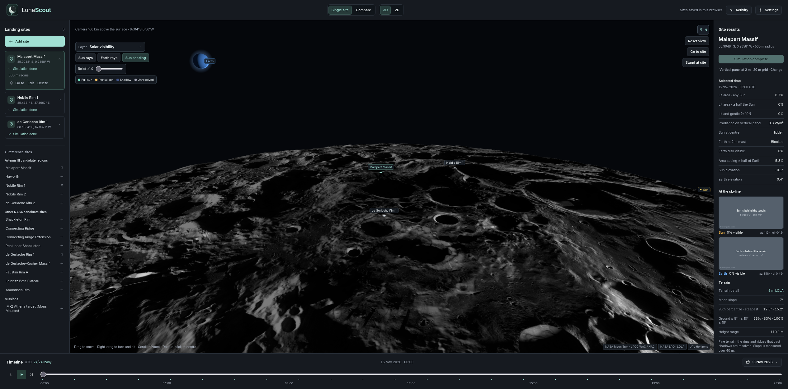
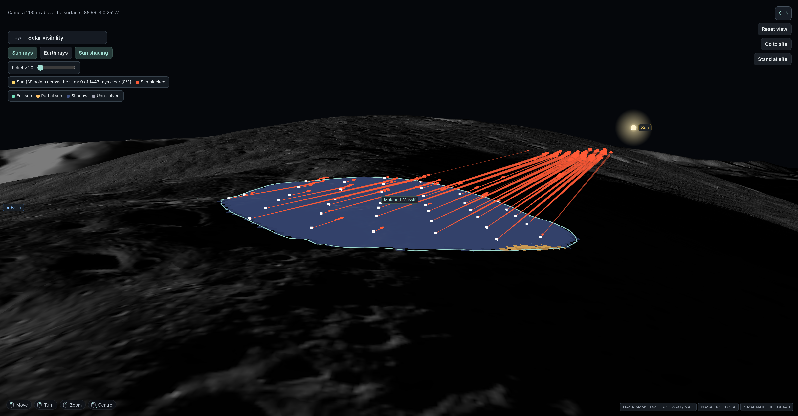
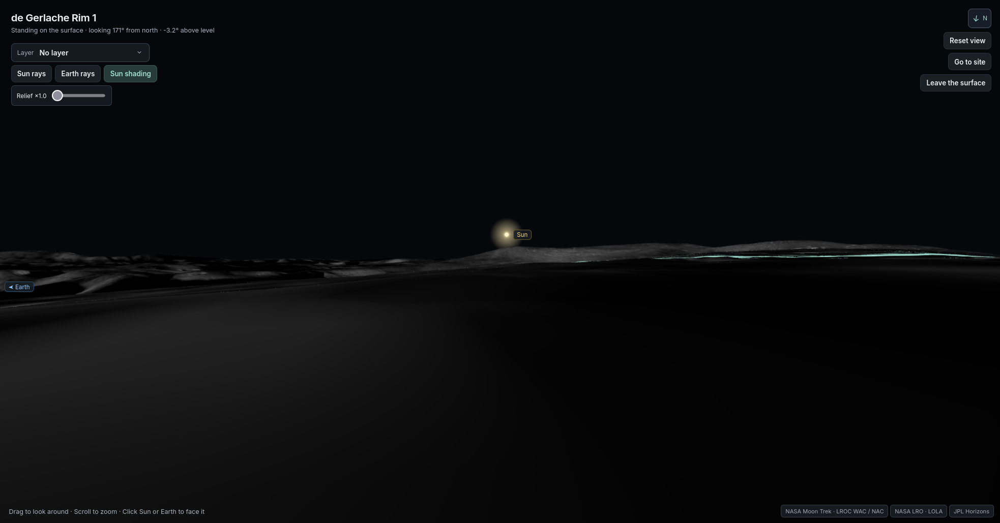
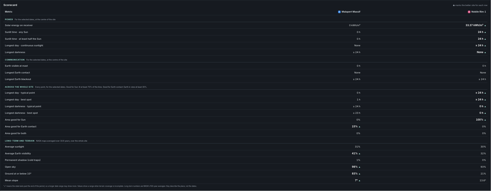
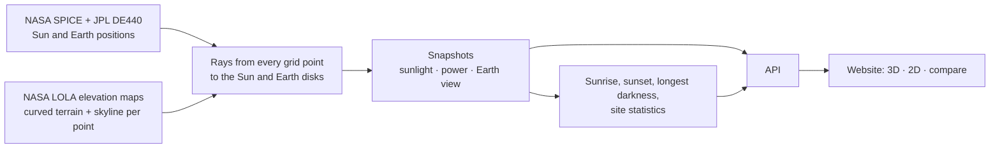

# LunaScout

**Compare lunar south-pole landing sites and dates by sunlight, power and line of sight to Earth.**

LunaScout is a web application built for the 2026 NASA Space Apps Challenge, *Lunar Landing Site Navigator*. It answers the two questions that decide a south-pole mission: will the lander have power, and can it talk to Earth? It traces real NASA terrain against JPL ephemerides to show, for any site and date range, which ground is lit, when the Sun and Earth rise and set, and how two candidate sites compare.

**Try it:** [luna-scout.online](https://luna-scout.online) · **Watch:** [the video tutorial](#video-tutorial)

## Video tutorial

[](docs/tutorial.mp4)

The animation above is the whole 84-second tutorial. **[Open it as a full-quality MP4](docs/tutorial.mp4)** for smoother motion and pause and seek controls. It is a screen recording of the real application, following the path a mission planner takes to choose a site:

1. **Choose the dates.** The Sun and Earth move, so every date gives different light and contact.
2. **Add sites.** Pick NASA's candidate sites from the reference list, or click the map to add your own.
3. **Run the simulation.** Sun and Earth positions come from JPL's DE440 ephemeris, and shadows are traced over every point of the site.
4. **Play through the day.** The ground is coloured by how much of the Sun each point sees.
5. **See why.** **Sun rays** and **Earth rays** show which points see the Sun and Earth and which ridge blocks them. **Stand at site** shows the horizon from the ground.
6. **Switch layers.** Earth radio coverage, the best spots over the dates, and NASA's long-term maps.
7. **Read the site's numbers.** The results panel holds the skyline, the terrain, and modelled ice and temperature, on the 3D view or the flat 2D map.
8. **Compare two sites.** Watch both on one timeline, then read the whole-period scorecard, where ▲ marks the better site on each measure.

The video studies 23 November 2026. On that date Shackleton Rim spends much of the day in shadow, and Connecting Ridge comes out ahead on every measure where the two differ. Most of the video plays at 1.5× speed, and the new site's simulation at 30×.

## Why it exists

Near the Moon's south pole the Sun never climbs far above the horizon. Ridges a few hundred metres away throw shadows that last for days, and a place that is lit today can be dark next week. Earth can disappear behind the same ridges. Small changes in site or launch date therefore change power and communication windows dramatically.

The tools that hold this data (NASA's Quickmap and Moon Trek, JPL Horizons) are built for specialists and answer one question at a time. LunaScout puts the terrain, the ephemerides and the physics behind one interface, so a mission planner can ask "what happens if the launch slips?" and see the answer, and a student can see why the Moon is hard.

## At a glance

| | |
|---|---|
| **Terrain** | NASA LOLA elevation models: 5 m around ten candidate sites, 80 m inside 80°S and 240 m out to 60°S |
| **Sun and Earth** | JPL DE440 ephemeris computed with NASA NAIF SPICE, checked monthly against JPL Horizons |
| **Physics** | Finite Sun disk, curved Moon, terrain shadows, Earth eclipses, no atmosphere |
| **Ice and temperature** | NASA Diviner model of temperatures and where ice would be stable, per site |
| **Imagery** | NASA Moon Trek LROC WAC and NAC mosaics |
| **Views** | Interactive 3D Moon and flat south-polar map, for one site or two side by side |

## What you can do

### Explore a site in 3D

The application opens on the Moon in 3D. The Sun and Earth sit where JPL's ephemeris puts them, and the terrain refines as you zoom from the whole globe down to individual rims and craters near the south pole. The Moon stays fixed and the sky moves around it, so playing the timeline never spins the scene.

Pick a site from NASA's candidate list or click anywhere between 60°S and 90°S to add your own, then press play. The map shows what each part of the site sees at the chosen time.



### See why a spot is dark

Turn on **Sun rays** to draw the rays the simulation traces from many points across the site to the Sun's disk. A ray that reaches the Sun is yellow; a ray cut off by terrain is red and stops at the ridge that blocks it. Here the whole site of Malapert Massif is in shadow because a ridge between the site and the Sun hides it:



### Check the line of sight to Earth

**Earth rays** does the same for Earth's disk, from mast height. Blue rays reach Earth and purple rays are blocked. The legend counts the rays that get through, and the **Earth radio coverage** layer colours every point of the site by how much of Earth it sees. Coverage here is geometric line of sight through the terrain, not a signal-strength or link-budget estimate.


### Stand on the surface

**Stand at site** puts the camera on the ground at the site centre, at mast height, and lets you look around. The Sun and Earth appear against the real horizon that the simulation uses, so you can see for yourself whether a ridge hides them. Click the **Sun** or **Earth** label to turn toward it.



### Compare two sites

**Compare** places two sites side by side, in 3D or 2D, on one shared timeline. Each pane shows four headline numbers, the Sun or Earth against the real horizon at true angular scale, and the same layers and rays. Layer settings are shared, so both sites always show the same thing.


### Read the numbers

The **Whole period** view turns the comparison into a scorecard, with a marker on the better site for every row. It is grouped into power, communication, whole-site statistics and long-term context:



- **Power and communication** for the selected dates: solar energy on the receiver, sunlit time, longest day, longest darkness, Earth visibility, longest Earth contact and longest blackout, with sunrise, sunset, Earthrise and Earthset timed to about one second at the site centre.
- **Across the whole site**: the longest day and longest darkness of the typical point and of the best spot, and the share of the site's area that is good for Sun, good for Earth contact and good for both.
- **Long-term and terrain**: NASA's 18.6-year averages for sunlight and Earth visibility, permanent shadow, open sky, and slope. They separate a bad day from a bad place.
- **Ice and temperature, modelled**: for the site only, NASA Diviner's annual mean and maximum temperature, the share of the site where ice would be stable, how much is stable right at the surface, and how deep the shallowest ice lies. These are model results at about 500 m, not detected ice. Measured hydrogen (neutron instruments) is mapped too coarsely to give a number for one site, so it is left out.

Two charts follow the scorecard, one for the Sun and one for Earth, each with a menu for what to plot (lit area, lit and gentle ground, irradiance, Earth disk visibility and others):


### Layers

One **Layer** menu, on the flat map and in 3D, chooses what is drawn on the ground:

| Layer | What it shows |
|---|---|
| Solar visibility | How much of the Sun each point sees at the timeline's time |
| Earth radio coverage | How much of Earth each point sees from mast height |
| Best spots for Sun, for Earth contact, for both | Points that are good over the whole selected period. Good for Sun means lit at least 70% of the time, good for Earth contact means Earth in view at least 30% |
| Average sunlight, average Earth visibility | NASA LOLA 18.6-year averages |
| Permanent shadow, open sky | Where the Sun never reaches, and how much sky the terrain leaves open |
| Slope | Steepness of the ground on the flat map |

## Quick start

**Requirements:** Python 3.12 or newer, [uv](https://docs.astral.sh/uv/), Node.js 22.12 or newer, and about 2 GB of disk space for NASA data (the 605 MB Diviner table is cut down to a 58 MB file during the download).

Open three terminals in the repository root.

```sh
# 1 · Worker: install, download NASA data (first time only), compute runs
cd backend
uv sync --locked
uv run --locked lunascout-science fetch-data
uv run --locked lunascout-worker
```

```sh
# 2 · API
cd backend
uv run --locked uvicorn lunascout.api.main:app --port 8000
```

```sh
# 3 · Website
cd frontend
npm ci
npm run dev
```

Open the URL Vite prints, usually <http://localhost:5173>. The API documentation is at <http://localhost:8000/docs>.

To keep NASA data somewhere else, set `LUNASCOUT_DATA_DIR` to the same absolute path in terminals 1 and 2. No network access is needed after `fetch-data`: the Sun and Earth are computed locally.

## Hosting

To run LunaScout on a server of your own, with HTTPS and protections for public use, follow [deploy/README.md](deploy/README.md).

## Good to know

- **Dates are UTC.** After **Run simulation**, the hour at the playhead is computed first, so there is something to look at at once.
- **Nothing is computed unasked.** Changing the dates asks the server what each site already has. If days are missing, a window lists them with the time they should take, and you choose **Compute missing dates** or **Keep previous dates**.
- **Nothing is computed twice.** Results are shared between date ranges, sites of the same settings, browsers and visitors. Narrowing the range deletes nothing.
- **Progress you can watch.** The progress window shows the run's stages as one bar, with a time left learned from this server's own timings. **Hide** shrinks it to a line above the timeline.
- **Pause, resume and cancel** act only on your own request. A simulation another visitor also wants keeps running for them, and a cancel deletes nothing.
- **Reference sites are precomputed** with the default settings and a 500 m radius, from the start of the month to the end of the next. A label such as "Ready to 31 Dec" shows which are done.
- **Site size.** New sites start with a 50 m radius; the largest is 500 m. The first run at a new site builds a terrain horizon map (about a minute at 500 m), which later runs at that centre reuse.
- **Activity menu** shows what the worker is doing and every recent simulation.

The reasons behind these behaviours are in [How the website behaves](docs/app-flows.md) and [Runs, reuse and the queue](docs/runs.md).

## How it works



In one paragraph: SPICE places the Sun and Earth in the Moon's own frame. The terrain is one curved surface built from NASA elevation maps, and each point's skyline is computed once. From every point of a site, 37 rays cross the Sun's disk and more cross Earth's; the skyline tells which are blocked. That gives sunlight, power and Earth visibility per point and per time, and scanning the site centre finds sunrise and sunset to a second. A worker does this in the background, saves the results, and the website only draws them.

**[The full explanation, with diagrams, is in docs/physics.md.](docs/physics.md)**

## Documentation

| Read | To learn |
|---|---|
| [Architecture](docs/architecture.md) | How the website, API, worker and queue fit together, and what is stored where |
| [How the physics works](docs/physics.md) | SPICE, terrain, the Sun disk, horizon maps, power, Earth visibility, events |
| [Runs, reuse and the queue](docs/runs.md) | How work is shared, who can stop it, precomputing and time estimates |
| [How the website behaves](docs/app-flows.md) | Date changes, adding sites, the progress window, the 3D view |
| [Decisions and why](docs/decisions.md) | The choices behind it and what each one costs |
| [API reference](docs/api.md) | The endpoints, grouped by purpose |
| [Data layout](DATA/README.md) | NASA inputs, caches, sizes |
| [Hosting guide](deploy/README.md) | Putting LunaScout on your own server |

## Command line

Compute a single snapshot without the web application:

```sh
cd backend
uv run --locked lunascout-science snapshot \
  --latitude -89.7668 --longitude -171.87 --radius-m 500 \
  --at 2026-11-14T12:00:00Z --receiver terrain --collector-height-m 0 \
  --output ../DATA/runs/my-snapshot
```

This writes `summary.json` and `grid.npz`. With these settings Shackleton Rim is 95.9% lit, which is the project's regression reference.

Other commands:

```sh
uv run --locked lunascout-science precompute                       # queue NASA's reference sites to the end of next month
uv run --locked lunascout-science precompute --from 2026-12-01 --through 2026-12-31
LUNASCOUT_HORIZONS_CONTACT='you@example.org' uv run --locked lunascout-science check-ephemeris
```

`precompute` only queues background work, which the worker computes whenever no visitor's simulation is waiting. `check-ephemeris` compares the Sun and Earth positions with JPL Horizons and appends the result to `DATA/logs/ephemeris-check.log`.

## Tests

```sh
cd backend
uv run --locked --with pytest python -m pytest tests
```

The suite covers the ray tracer, the horizon method against direct tracing, event timing, run queueing and reuse, elevation tiles, the rays and the per-point statistics. Tests that need the NASA data are skipped when it has not been downloaded. The frontend is checked with `npm run check` (TypeScript) and `npm run build`.

## Accuracy and limitations

The reasoning behind each is in [docs/physics.md](docs/physics.md#limits).

- **Earth coverage is geometric.** It says whether terrain blocks the line to Earth, not whether a link would close. Antenna patterns, link budgets and Earth's atmosphere are not modelled.
- **Terrain detail.** About 90% of the 5 m cells are interpolated between LOLA laser tracks (Barker et al. 2021), so grid spacing is not the same as measured detail. Each site reports which resolution it was computed from.
- **Not modelled:** reflected light and Earthshine.
- **Short events.** Events lasting under a minute can be missed.
- **Coverage.** Terrain support is 60°S to 90°S. Sites can be saved elsewhere but are not simulated.
- **Per-point statistics** treat each hourly snapshot as holding for its whole hour. The exact event times come from the site-centre windows.
- **Good-spot standards.** The 70% and 30% thresholds are judgements, shown in the interface, not NASA requirements.

## Data sources

All data comes from NASA.

- [LOLA 5 m south-pole site DEMs](https://pgda.gsfc.nasa.gov/products/78) (Barker et al. 2021) and [LOLA regional DEMs](https://pgda.gsfc.nasa.gov/products/90)
- [Lunar polar illumination, Earth visibility and sky visibility maps](https://pgda.gsfc.nasa.gov/products/69) (NASA Goddard PGDA)
- [Diviner Polar Resource Product](https://ode.rsl.wustl.edu/moon/pagehelp/Content/Missions_Instruments/LRO/DIVINER/PRP.htm) (NASA PDS): modelled temperatures and ice-stability depth for the south pole. Its mesh is built on Kaguya (JAXA) topography.
- [NAIF SPICE kernels](https://naif.jpl.nasa.gov/naif/data.html), including JPL's DE440 planetary ephemeris, and [JPL Horizons](https://ssd-api.jpl.nasa.gov/doc/horizons.html) for the monthly cross-check
- [NASA Moon Trek](https://trek.nasa.gov/moon/), LROC WAC and NAC imagery
- Reference sites: [NASA Lunar Surface Data Book](https://ntrs.nasa.gov/citations/20230007818), Table A2-2

Open-source software: React, Three.js, OpenLayers, Vite, FastAPI, NumPy, Numba, Rasterio and SpiceyPy.
