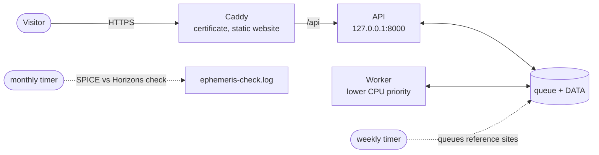

# Hosting LunaScout on a VM

This puts LunaScout on a small Google Cloud server at your own domain, using the free trial credit. It takes about an hour, most of it waiting for downloads.

**What ends up running:** a web server (Caddy) that serves the website over HTTPS and passes `/api` to the API, the API itself, and the simulation worker. The API and worker restart on their own after a reboot.



For how these parts work together, see [docs/architecture.md](../docs/architecture.md).

## Before you start

- Push the repository to GitHub and make it public. The server downloads the code from there.
- Have an email address ready for JPL Horizons. The application computes the Sun and Earth itself; once a month a check compares them with Horizons, and JPL asks automated clients to identify themselves. The address is stored only on the server, never in the repository.

## 1. Google Cloud account

1. Sign up at <https://cloud.google.com/free> and claim the $300 trial credit (90 days). It asks for a card to confirm you are a person; it does not charge you unless you upgrade.
2. **Set a budget alert**, so a mistake cannot cost you: Billing, Budgets and alerts, create a budget of $50 with alerts at 50%, 90% and 100%.

## 2. Create the server

Compute Engine, VM instances, **Create instance**:

| Setting | Value |
|---|---|
| Name | `lunascout` |
| Region | The closest one to your judges and you (for example `europe-west3`, Frankfurt) |
| Machine type | `e2-standard-2` (2 vCPU, 8 GB memory). Roughly $50 a month, so the credit lasts the whole trial |
| Boot disk | Ubuntu 24.04 LTS, 50 GB, balanced persistent disk |
| Firewall | Tick **Allow HTTP traffic** and **Allow HTTPS traffic** |

If simulations are too slow later, choose `e2-standard-4` (about twice the cost and speed). To precompute the reference sites faster, resize to a larger E2 type for a few hours (stop the VM, change the machine type, start it), then resize back. Time estimates are learned per CPU count, so they stay honest after a resize. A new Google Cloud account may have no quota for the compute-optimised C2 types; E2 types work.

## 3. Give it a fixed address

By default the address changes when the server restarts. Reserve one:
VPC network, IP addresses, find the server's external address, and change its type from **Ephemeral** to **Static**. Note the address.

## 4. Point your domain at it

In Namecheap: Domain List, `luna-scout.online`, **Manage**, **Advanced DNS**.
Delete the default parking records, then add:

| Type | Host | Value |
|---|---|---|
| A Record | `@` | the server's static address |
| CNAME Record | `www` | `luna-scout.online.` |

The second record makes `www.luna-scout.online` forward to `luna-scout.online`. DNS can take a few minutes to update. HTTPS will not work until it has.

## 5. Install

On the VM page, press **SSH** to open a terminal in the browser, then run:

```sh
git clone https://github.com/SimeonVutov/Luna_Scout.git
sudo ./Luna_Scout/deploy/setup.sh luna-scout.online YOUR_EMAIL
```

Use your own email for `YOUR_EMAIL`. The script installs what is needed, downloads the NASA data (about 2 GB, including a 605 MB table that is cut down and deleted), builds the website, starts the services and sets up HTTPS. It makes its own copy of the code in `/srv/lunascout/app` so that the service account can use it, so you can delete the folder you cloned.

When it finishes, open <https://luna-scout.online>. The site is served over HTTPS with a free certificate that renews itself. Anyone who opens `http://luna-scout.online` or `www.luna-scout.online` is forwarded to `https://luna-scout.online`; keep port 80 open (the **Allow HTTP traffic** box) because that forwarding and the certificate check both use it.

## 6. Check that it works

- The page loads over HTTPS, and the 3D Moon appears.
- Add a reference site and press **Run simulation**. The first run at a new site takes a few minutes on this machine, because it builds the terrain's horizon map once.
- If something is wrong, look at the logs:

```sh
journalctl -u lunascout-api -n 50
journalctl -u lunascout-worker -n 50
journalctl -u caddy -n 50
```

## Precomputed reference sites

A weekly timer queues NASA's reference sites, from the first of the current month to the end of the next, with the website's default settings. The worker computes them only while no visitor's simulation is waiting, and runs at a lower CPU priority than the API, so the website stays responsive. The first pass builds a terrain horizon map for each of the 15 sites, then computes each day; expect it to take hours on this machine. Progress shows in the Activity menu. To queue it now, or for other dates:

```sh
sudo systemctl start lunascout-precompute
sudo -u lunascout bash -c 'cd /srv/lunascout/app/backend && set -a && . /etc/lunascout.env && .venv/bin/lunascout-science precompute --through 2027-01-31'
```

## Monthly ephemeris check

A timer compares the application's Sun and Earth positions with JPL Horizons once a month. Each run adds one line to `/srv/lunascout/DATA/logs/ephemeris-check.log`, and a difference over 1 km, or a failure to reach Horizons, marks the run as failed. Nothing appears on the website. To read the log, or run the check now:

```sh
sudo tail /srv/lunascout/DATA/logs/ephemeris-check.log
sudo systemctl start lunascout-ephemeris-check
systemctl list-timers lunascout-ephemeris-check.timer
```

## Updating

Push your changes to GitHub, then on the server:

```sh
sudo /srv/lunascout/app/deploy/setup.sh luna-scout.online YOUR_EMAIL
```

It pulls the new code, rebuilds the website and restarts the services. Saved results are kept.

## What the public setting does

The server runs in public mode (`LUNASCOUT_PUBLIC_MODE=1`, set in `/etc/lunascout.env`), because anyone on the internet can reach it:

- **Each visitor's sites stay in their own browser.** The server-side site list is turned off, so visitors cannot change each other's sites.
- **Deleting saved results is turned off.** Results are shared between visitors.
- **Runs are limited:** at most 35 days, a site radius up to 500 m, a grid spacing of at least 20 m, and at most 20 visitors' simulations waiting at once; simulations already covered by stored results do not count. A busy server answers "try again in a few minutes".
- **Heavy requests are rate limited** per visitor.
- **Pause and cancel only affect the visitor's own request.** A simulation several visitors asked for keeps running until none of them wants it, and the precomputed reference sites are never stopped by a visitor. A cancel deletes nothing; results nobody has asked for in 14 days are cleaned up when the worker starts.

To run privately, remove the `LUNASCOUT_PUBLIC_MODE` line from `/etc/lunascout.env` and run `sudo systemctl restart lunascout-api`.

## Things to know

- **Memory.** Each site's terrain takes a few hundred megabytes, and the API and worker each load some. If the server runs out of memory, services restart by themselves; check `free -h` and consider the larger machine.
- **After the trial.** The free credit lasts 90 days. When it ends the server stops; nothing is charged unless you upgrade. Download anything you want to keep, or move to a cheap provider and run the same script.
- **Security.** This setup has no sign-in. It limits what a visitor can do, but it is a demo server, not one to put private data on.
- **If a step fails,** read the error and the service logs above first. Setup is safe to run again: it only changes what is missing.
