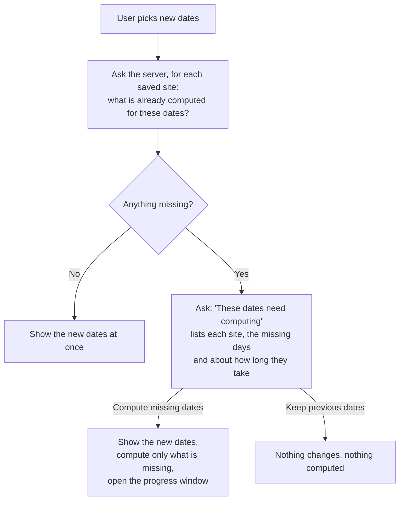
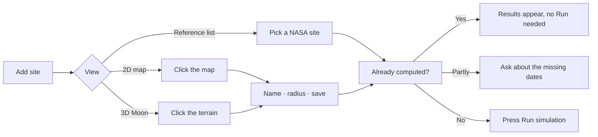
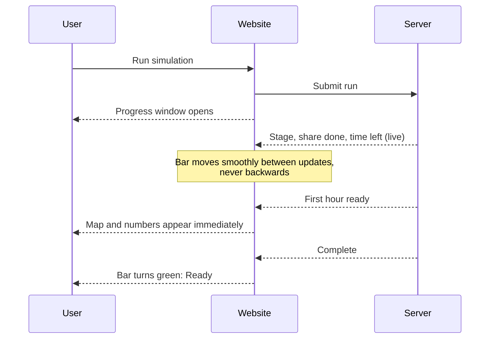

# How the website behaves

The website follows one rule: **it never starts expensive work without the user knowing.** Looking is free. Computing is always something the user asked for or agreed to. This page describes the main flows and why they work that way.

## Changing the dates

One timeline is shared by every site. Changing it can leave some sites without results for the new days, so the website asks the server first.

- The server's answer comes from the [sample reuse](runs.md#nothing-is-computed-twice) described earlier, so "missing" means missing *after* copying everything other runs already hold.
- The time estimate comes from [timings learned on that server](runs.md#progress-and-time-left).
- Closing the question (Escape, or clicking outside) counts as keeping the previous dates.
- A site the server could not answer about is left out rather than blocking the change.

Adding a **reference site** that the server has precomputed only partly (for example it holds up to the end of next month, and the timeline is longer) asks the same question, with "Not now" instead of "Keep previous dates", because there are no previous dates to return to.

## Adding a site

**Clicking in 3D.** A click is a line from the camera through the mouse. Instead of intersecting it with a smooth ball, the website walks along the line and checks it against the *terrain it has drawn*, in steps small enough not to jump over a crater rim. Where the line first goes below the ground is the site, so the marker lands exactly where the pointer is, even on a steep rim, and there is no jump to the 2D map.

## Running a simulation

- **The first hour is computed first**, so the user sees a result before the run finishes. The rest fills in as it is computed.
- **Hide** shrinks the window to a line above the timeline. The run does not depend on the window being open.
- **Pause, resume and cancel** work as described in [Who can stop a run](runs.md#who-can-stop-a-run).
- If the browser is closed, the run continues on the server. Run IDs are remembered in the browser, and results are matched by request, so reopening the site with the same dates shows them again, from any browser.

## The 3D view

- **The Moon stays still; the sky moves.** Playing the timeline moves the Sun and Earth around the Moon, so the terrain never spins under your eyes and you can see which ridge the light is crossing.
- **Terrain streams in as tiles** on the same grid as NASA's photos (Moon Trek). Each tile refines as the camera approaches, from the whole globe down to about 4 m.
- **Rays come from the simulation, not from the browser.** The worker saves, with every snapshot, rays from about 40 points across the site. The 3D view only draws them: yellow reach the Sun, red are blocked and stop at the ridge, blue and purple are the same for Earth. For a time the simulation has not reached yet, the server traces the rays on demand, which is slower.
- **Stand at site** puts the camera at mast height at the site centre and draws the Sun and Earth against the same skyline the simulation used. What you see is what the numbers assume.

## Comparing two sites

Compare puts two sites side by side on **one timeline**, with shared layer settings so both always show the same thing. The scorecard marks the better site on each row (▲), and the charts plot both over the selected period. Each site is an ordinary run, so comparing never computes anything a single site would not.

## What stays in the browser

| Kept in the browser | Why |
|---|---|
| Your saved sites (on a public server) | Visitors cannot see or change each other's sites |
| The IDs of runs you started | To show them again on reload |
| A random session ID | So pause and cancel affect only your own request |

Nothing in the browser is needed to *read* a result: anyone who asks for the same site, dates and settings gets the same run.
