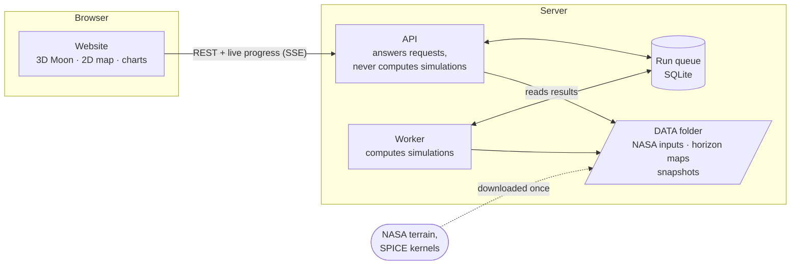
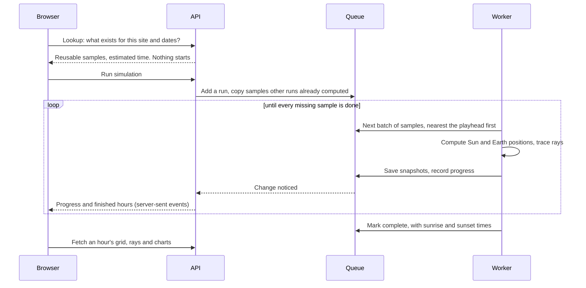
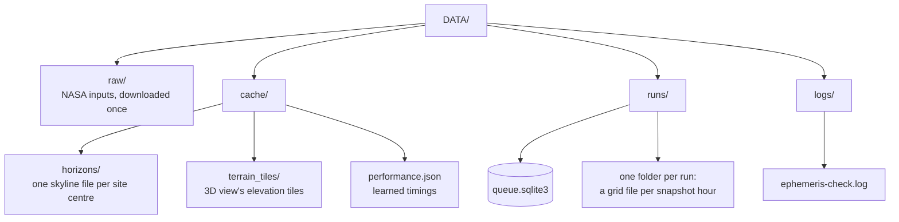

# Architecture

LunaScout is three programs that share one folder of files and one small database. The website asks questions, the API answers quickly, and a separate worker does the slow physics.

## Why the work is split in two

A simulation can take minutes or hours. If the API did it, every visitor would wait behind it, and a restart would lose it. So:

- **The API only reads and queues.** It answers in milliseconds and stays responsive however busy the server is.
- **The worker computes.** It takes the next piece of work from the queue, saves the result to disk, and records progress. If it is restarted, it continues from what is saved.
- **The queue is a SQLite file.** It is the only thing the two programs share besides result files, so there is no message broker to run or lose.

## One request, end to end

Two details make this feel fast:

- **The playhead goes first.** The worker computes the hour the user is looking at before the rest, so something appears within seconds. If the user moves the timeline, the order follows.
- **Nothing is computed twice.** A new request first copies any samples earlier runs of the same site and settings already hold. See [Runs, reuse and the queue](runs.md).

## What each part is responsible for

| Part | Responsibility | Lives in |
|---|---|---|
| Ephemeris | Where the Sun and Earth are, seen from the Moon, at any time | `backend/lunascout/ephemeris` |
| Terrain | One curved, multi-resolution surface from NASA elevation data, and each point's skyline | `backend/lunascout/terrain` |
| Simulation | Rays, sunlight, Earth visibility, sunrise and sunset, per-point statistics | `backend/lunascout/simulation` |
| Jobs | The queue, the worker, progress and time estimates | `backend/lunascout/jobs` |
| API | HTTP routes, public-server protections | `backend/lunascout/api` |
| Website | 3D and 2D views, timeline, comparison, progress window | `frontend/src/features` |

The physics is explained in [How the physics works](physics.md); the website's behaviour in [How the website behaves](app-flows.md).

## The website has no simulation code

Everything shown, the numbers, the rays in 3D, the skyline, comes from files the worker saved. The browser only draws them. This is deliberate: the picture and the numbers cannot disagree, because both are read from the same saved snapshot.

The one exception is the Sun and Earth positions drawn in the sky, which the API computes with the same SPICE code and sends as small batches.

## Where things are stored

Everything under `raw/` can be downloaded again. Everything under `cache/` can be rebuilt, only slower. `runs/` holds the results people asked for. See [DATA/README.md](../DATA/README.md) for the file list and sizes.
