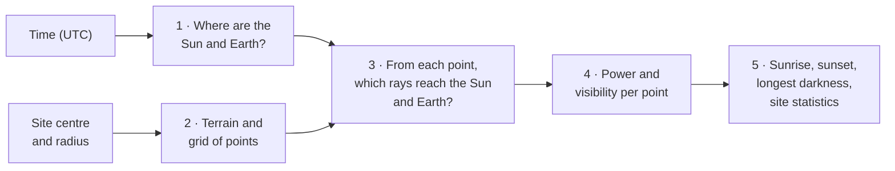
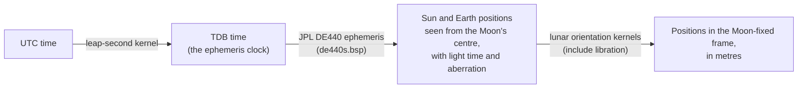
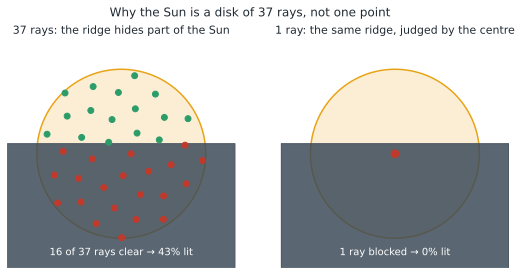
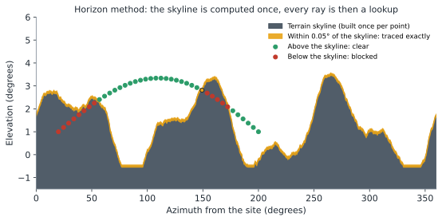
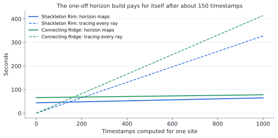
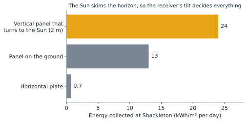
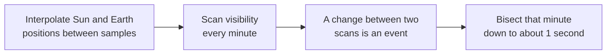

# How the physics works

For one site and one moment, LunaScout answers: **how much of the Sun does each point see, how much power does a panel there collect, and can it see Earth?** Repeated over a date range, that gives sunrise, sunset, longest darkness and comparisons between sites.

## 1 · Where are the Sun and Earth?

The Moon turns once a month and wobbles (libration), so a direction that is "south-east" on the Moon points at a different place in the sky every hour. To place the Sun and Earth over the terrain we need their positions in the **Moon's own frame**, the same frame the terrain heights are measured in.

We use NASA's **NAIF SPICE** toolkit with the **JPL DE440** planetary ephemeris, the same data family NASA missions use. SPICE runs on our own server: a position takes microseconds, works for any date from 1849 to 2150, and needs no internet.

- **Light time and aberration** (`LT+S`) are applied at the Moon's centre. This is what an observer on the Moon would see, since light from the Sun left 8 minutes ago and the Moon is moving. At a point on the surface the remaining error is below 0.003″.
- **The Moon-fixed frame** is `MOON_ME_DE440_ME421`. It is within about 0.5 m of the frame the NASA elevation maps use, so terrain and sky line up.
- **Libration** comes from NASA's time-varying orientation kernel. We do not model it ourselves.
- **Surface parallax** is handled per ray: each ray starts at its own point on the surface, and the Sun's direction is computed from that point, not from the Moon's centre.

In symbols, SPICE gives the Moon-centred positions in the inertial J2000 frame (kilometres), which are rotated into the Moon-fixed frame and converted to metres, and then each ray's direction is measured from its own origin:

$$\mathbf{r}_{\mathrm{MF}} = 1000\;\mathbf{Q}(t)\,\mathbf{r}_{\mathrm{J2000}}, \qquad \mathbf{v}_{\odot} = \mathbf{r}_{\odot} - \mathbf{x}, \qquad \mathbf{v}_{\oplus} = \mathbf{r}_{\oplus} - \mathbf{x}$$

where $\mathbf{Q}(t)$ is the J2000-to-lunar rotation matrix at time $t$ (it contains libration), $\mathbf{r}_{\odot}$ and $\mathbf{r}_{\oplus}$ are the Sun's and Earth's Moon-centred positions, $\mathbf{x}$ is the ray's origin on the surface, and $\mathbf{v}_{\odot}$, $\mathbf{v}_{\oplus}$ point from that origin to the Sun and Earth.

### Why SPICE, and not JPL Horizons

The first version asked JPL's Horizons web service for positions. That worked but needed the internet, was rate limited, and every request took time. Both serve the same ephemeris family, so we compared them:

| Over 2026–2028 | Largest difference | As seen from the Moon |
|---|---|---|
| Sun | 35 m | 0.00005″ |
| Earth | 5 m | 0.0025″ |

That is thousands of times smaller than the Sun's width (about 0.5°), and in a test over 10 snapshots at two sites no point's result changed. So SPICE replaced Horizons for all computing.

Horizons is still used **once a month** as a safety check. A timer compares SPICE with Horizons at 12 times over the next 60 days and writes the largest difference to `DATA/logs/ephemeris-check.log`. It is flagged as failed if the difference exceeds 1 km. It is not shown on the website. It is the only thing that uses Horizons, and JPL asks automated clients to identify themselves, so the contact address is stored only on the server.

## 2 · The terrain

No single NASA map covers everything at the detail we want, so we combine three and always use the finest one available:

| Source | Spacing | Used |
|---|---|---|
| LOLA site maps | 5 m | Around 10 candidate sites, within 60 km of the site |
| LOLA 80°S map | 80 m | Within about 120 km of the site |
| LOLA 60°S map | 240 m | Everything out to 60°S, for far horizons |

- **Curved, not flat.** Every grid cell is split into two triangles on the real Moon (radius 1,737.4 km). Over the tens of kilometres that matter, a flat map would hide ridges that the curvature really tucks below the horizon.
- **No false cliffs.** Where a fine map meets a coarser one, their edges are stitched so no wall appears at the seam.
- **Missing data is never assumed to be empty sky.** A ray that crosses terrain we do not have is reported as *unresolved*, and every result carries a lower and an upper bound.
- **Honesty about detail.** About 90% of the 5 m cells are interpolated between laser tracks (Barker et al. 2021). Each site reports how much of its area came from each resolution.

## 3 · Is a point lit? The Sun is a disk, not a dot

At the south pole the Sun skims the horizon, so a ridge usually hides only *part* of it. Treating the Sun as a single point gives answers that are all-or-nothing and often wrong.

Each point casts **37 rays**, spread so each one stands for an equal area of the Sun's disk. The share that reaches the Sun is the lit fraction. In our test a single centre ray reported Shackleton as 86% lit where the full disk gives 96%.

How the rays are placed on the disk, for ray $i = 0, 1, \dots, N-1$ of $N = 37$:

$$r_i = R\,\sqrt{\frac{i + \tfrac{1}{2}}{N}}, \qquad \psi_i = i\,\pi\,(3 - \sqrt{5})$$

Here $R$ is the disk's angular radius, $r_i$ is the ray's distance from the disk centre, and $\psi_i$ is its angle around the centre. The square root gives every ray an equal share of the disk's area. The angle step $\pi(3-\sqrt{5}) \approx 137.5^\circ$ is the golden angle, so rays never line up in rows.

With $V_j = 1$ if ray $j$ is clear and $0$ if it is blocked, the lit fraction of the Sun is

$$f = \frac{1}{N}\sum_{j=1}^{N} V_j$$

Rays that cross terrain we have no data for are *unresolved*. They give two bounds instead of one number: $f_{-}$ counts only rays known to be clear, and $f_{+}$ counts every ray not known to be blocked, so $f_{-} \le f \le f_{+}$.

Earth is treated the same way, with its own disk of rays. Earth can also pass in front of the Sun (an eclipse), and that is masked per ray.

## 4 · Making it fast: horizon maps

Terrain does not move. Only the Sun and Earth do. So for every grid point, once, we compute its **skyline**: the highest terrain angle in each of 720 directions, measured exactly on the triangulated surface. After that, deciding whether a ray is blocked is a lookup.

For a point, the skyline $h(\alpha)$ is the largest elevation angle $\varepsilon$ of any terrain seen in direction $\alpha$ (azimuth). A ray towards elevation $\varepsilon$ and azimuth $\alpha$ is then classified by comparing the two:

$$\text{ray} = \begin{cases} \text{clear} & \varepsilon \gt h(\alpha) + \delta \\ \text{blocked} & \varepsilon \lt h(\alpha) - \delta \\ \text{traced exactly} & \text{otherwise} \end{cases} \qquad \delta = 0.05^\circ$$

- A ray **above** the skyline is clear. A ray **below** is blocked.
- A ray within $\delta = 0.05^\circ$ of the skyline is too close to call from a table, so it is traced exactly with the full ray tracer.
- The answers are identical to tracing every ray. We checked: 0 differences in 378,473 point-and-time combinations at each of two sites.

This is the method behind NASA's own LOLA illumination maps (Mazarico et al. 2011).

| Site (1,961 points, 193 timestamps) | Build, once | Per timestamp | Faster than tracing |
|---|---|---|---|
| Shackleton Rim | 44 s | 21 ms | 15.6× |
| Connecting Ridge | 66 s | 12 ms | 34.5× |

With a build time $B$, a time $p$ per timestamp with horizon maps and $p_{d}$ without them, the time for $n$ timestamps is $B + p\,n$ against $p_{d}\,n$, so the build pays for itself once

$$n \gt \frac{B}{p_{d} - p} \qquad\Longrightarrow\qquad n_{\text{Shackleton}}^{\ast} \approx \frac{44}{0.328 - 0.021} \approx 143, \quad n_{\text{Connecting}}^{\ast} \approx \frac{66}{0.414 - 0.012} \approx 164$$

where $p_{d}$ is the measured $p$ times the speed-up factor in the table. A two-month run has about 5,800 timestamps, so the build is a small cost. The dashed lines in the chart are drawn from the same numbers.

**Skylines are shared.** One file is kept per site *centre*, not per run. A smaller radius at the same centre (for the grid points the two sites share), a different date range, or a different visitor all reuse it. The file is keyed by the terrain data and the receiver heights, so a change to either rebuilds it automatically. Pure ray tracing is still available as `ray_method: "direct"`, mainly for testing.

## 5 · How much power?

A panel collects sunlight from each clear ray in proportion to the cosine of the angle between the ray and the panel's normal (Lambert's cosine law):

$$c_j = \max\!\left(0,\; \hat{\mathbf{n}} \cdot \hat{\boldsymbol{\omega}}_j\right)$$

where $\hat{\mathbf{n}}$ is the panel's unit normal and $\hat{\boldsymbol{\omega}}_j$ is the unit direction of ray $j$. The flux facing the Sun falls with the square of the distance, and the rays are averaged over the disk:

$$S = S_1\left(\frac{\mathrm{AU}}{d}\right)^{2}, \qquad F = \frac{S}{\langle\cos\theta\rangle}, \qquad G = F\,\frac{1}{N}\sum_{j=1}^{N} c_j\,V_j$$

| Symbol | Meaning |
|---|---|
| $S_1 = 1361\ \mathrm{W/m^2}$ | The Sun's output at Earth's average distance (the IAU nominal value) |
| $d$ | Distance from the receiver to the Sun's centre, which changes through the year |
| $\mathrm{AU}$ | The astronomical unit, 149,597,870,700 m |
| $\theta$ | Angle between a ray and the disk centre. Dividing by $\langle\cos\theta\rangle$ (the mean over the rays) makes a fully lit panel facing the Sun collect exactly $S$ |
| $V_j$ | 1 if ray $j$ is clear, 0 if blocked |
| $G$ | Direct irradiance on the panel, in W/m² |

- The panel is a **vertical panel that turns toward the Sun, 2 m above the ground**, as on real polar landers. Other receivers (ground, horizontal) can be chosen in Settings.

A flat plate collects almost nothing because the Sun is always near the horizon, which is why the default receiver matters so much.

## 6 · Can it see Earth?

A mast (2 m by default) at the site centre sends 37 rays across Earth's disk. The share that is clear is the visible fraction of Earth. The 3D view and the *Earth radio coverage* layer repeat this from many points across the site.

This is **geometric line of sight only**. It does not include antenna patterns, link budgets or ground-station schedules.

## 7 · Sunrise, sunset and contact times

Area metrics are sampled every 15 minutes, which is too coarse for event times. The site centre is therefore scanned separately:

Each bisection halves the interval that contains the event, so after $k$ steps it is known to within

$$\Delta t_k = \frac{60\ \mathrm{s}}{2^{k}}, \qquad \Delta t_6 = \frac{60}{64}\ \mathrm{s} \lt 1\ \mathrm{s}$$

Interpolating positions over 15 minutes costs less than $0.0001^\circ$ of error. An event shorter than one minute can still be missed between two scans.

## 8 · From samples to site statistics

- **Over time.** Area metrics are integrated with the trapezoid rule, split at UTC midnights so each day gets its own total. For a quantity $q$ sampled at times $t_k$, such as irradiance:

  $$\int q\,dt \;\approx\; \sum_{k} \frac{q(t_k) + q(t_{k+1})}{2}\,\bigl(t_{k+1} - t_k\bigr)$$

  Integrating irradiance $G$ gives energy per square metre, which the page shows in kWh/m².
- **Across the site.** Each saved snapshot is combined into every point's longest day, longest darkness, share of time lit and share of time with Earth in view. These feed the *best spots* layers and the whole-site rows in the comparison. Each hourly snapshot is taken to hold for its whole hour.
- **Slope** is a central difference of terrain height $h$ between neighbouring grid points a distance $s$ apart, so the baseline is $2s$ (40 m on the 20 m grid of a large site, 10 m on the 5 m grid of a small one):

  $$\beta = \arctan\sqrt{\left(\frac{\partial h}{\partial E}\right)^{2} + \left(\frac{\partial h}{\partial N}\right)^{2}}, \qquad \frac{\partial h}{\partial E} \approx \frac{h(E+s) - h(E-s)}{2s}$$

  and the same for north. It is smoother than the 5 m data itself, and over tens of metres the Moon's curvature is ignored.
- **Lit and gentle** counts a point when at least half the Sun is visible *and* the slope is at most 10°, the limit used in NASA-supported landing-site studies: $f \ge 0.5$ and $\beta \le 10^\circ$.
- **Good spot** thresholds (lit at least 70% of the time, Earth in view at least 30%) are our judgement, shown in the interface, not NASA requirements.

## 9 · Long-term context from NASA

Two things come straight from NASA rather than our simulation, so they can be compared with it:

- **Illumination maps** (18.6-year average sunlight and Earth visibility, permanent shadow, open sky) from NASA Goddard. They separate a bad *day* from a bad *place*.
- **Ice and temperature** from NASA's Diviner instrument: modelled temperatures and the depth where ice would be stable, in cells of about 500 m. These are model results, not detected ice.

## Limits

- Earth coverage is geometric, not a signal-strength estimate.
- Reflected light and Earthshine are not modelled; the Moon has no atmosphere to scatter light.
- Terrain support is 60°S to 90°S; 5 m detail exists only around the ten listed sites.
- Events shorter than a minute can be missed.
