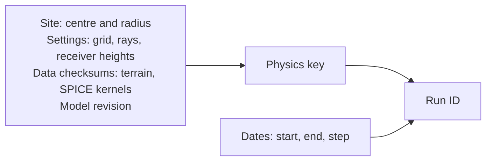
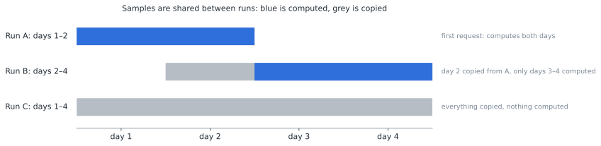
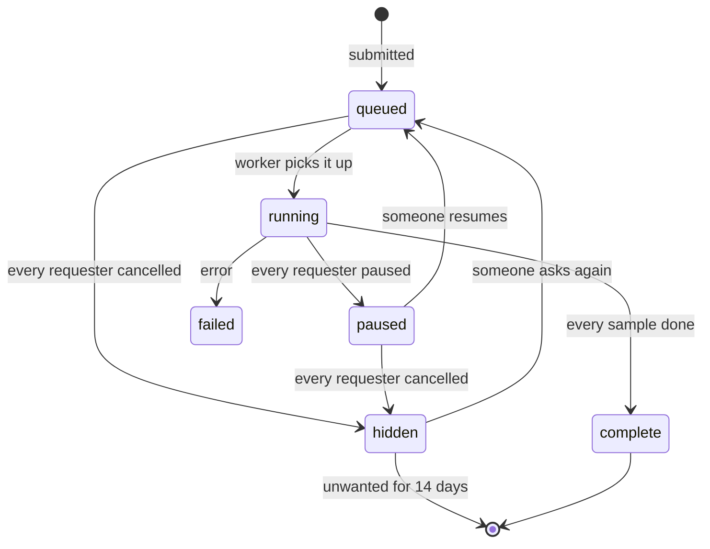
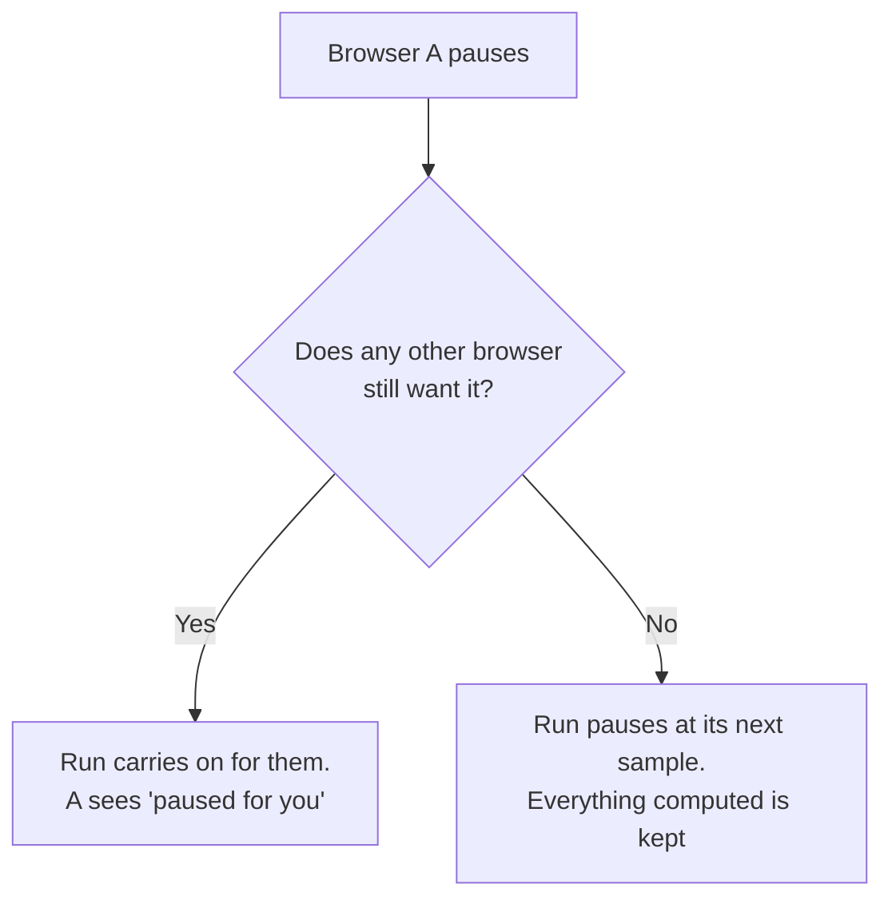
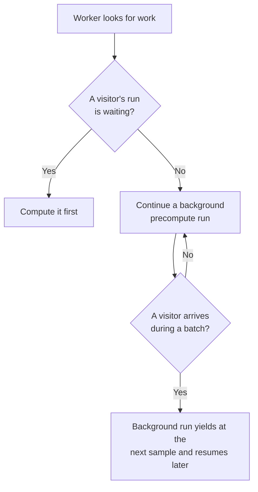
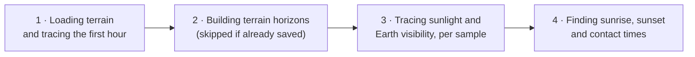

# Runs, reuse and the queue

A **run** is one simulation request: a site, a date range and the settings. This page explains how runs are identified, how they share work, who can stop them, and how the progress window knows how long is left.

## What identifies a run

Every run is named by a fingerprint of everything that affects its result:

- Asking for the same thing twice, from any browser, gives the **same run**, so its results are simply shown.
- Changing the NASA data or bumping the model revision changes the fingerprint, so old results are never mistaken for new ones. They stay readable but are not reused.
- The **physics key** is a fingerprint of everything *except* the dates; the run ID adds the dates to it. Two runs with the same physics key compute identical samples at identical times. That is what makes sharing possible.

## Nothing is computed twice

A simulation is a list of **samples**, one per 15 minutes. A sample depends only on the physics key and the time, not on which run asked for it.

When a run is submitted, the server first **copies every matching sample** from earlier runs of the same physics key, linking their snapshot files instead of duplicating them. The worker then computes only the gaps.

- This also works **while runs are still running**: if two overlapping runs are queued together, whichever reaches a shared time first computes it, and the other takes it.
- Measured: a 3-day run over a finished 1-day run reused 96 of its 289 samples, and the reused day's totals matched the original to the last digit.
- Narrowing the timeline deletes nothing, so widening it again is instant.
- One detail: the last sample of a range is its closing edge. When a longer range turns that edge into an ordinary interior hour, it is recomputed, because the shorter run never saved a snapshot file for it.

## The life of a run

The website never starts work by surprise. It first **looks up** what the server already has (a read-only question) and starts a run on its own only when every sample is already known. Anything missing is computed only when the user presses Run or agrees to the "These dates need computing" question. See [How the website behaves](app-flows.md).

## Who can stop a run

A run is shared, so one visitor must not be able to stop it for another. Instead of one "stop" flag, the server records **which browsers want the run**:

- **Pause / resume** change only that browser's request. The run stops when nobody wants it, and continues from where it stopped.
- **Cancel** withdraws the browser's request and hides the run from it. It **deletes nothing**: the samples stay for reuse.
- Runs nobody has asked for in **14 days** are cleaned up when the worker starts. Samples that other runs have already copied stay, because the copies are independent.
- A custom site you delete has its results removed to save space. A **reference site** keeps its results, hidden, for 14 days, so adding it back restores them.

## Visitors first, precompute in the background

NASA's 15 reference sites are computed ahead of time, so the first visitor to open one sees results at once. This is background work and must never slow a visitor down.

- A weekly timer queues each reference site from the start of the current month to the end of the next, with the website's default settings and a 500 m radius.
- The worker process runs at a lower CPU priority than the API, so the website stays responsive even while precomputing.
- A visitor's browser cannot pause or cancel a precompute run; they are owned by the server.
- Because horizon maps are shared per site centre, a visitor adding the same site with a smaller radius reuses the 500 m skyline and is quick too.

## Progress and "time left"

A run moves through up to four stages. The progress window draws them as one bar, and a stage that has nothing to do is left out.

The estimate of time left is **learned from this server's own work**, not guessed:

1. After every stage, the worker records how long it took and how much work it was (grid points, samples, days).
2. Each kind of work is modelled as a fixed cost plus a cost per unit of work, fitted to the last 40 observations so the model follows changes:

   $$t = a + b\,n \qquad\text{and}\qquad t_{\text{left}} = \sum_{\text{stages not done}} \left(a_s + b_s\,n_s\right)$$

   where $n$ is the amount of work (grid points, points of skyline to build, samples, days) and $a$, $b$ are the fixed and per-unit costs learned for that kind of work.
3. Observations are kept **per CPU count**. Resize the server from 8 cores to 2 and it starts a new, empty model instead of promising 8-core times.
4. Until a server size has been measured, the estimate is scaled from another size or from typical values, and the window says how reliable it is.
5. If several visitors' runs are being computed, the time left includes the share of the server they take, and the window says "Sharing the server with N other simulations".

Two honesty rules for the window:

- A stage that counts real work (points, samples) shows real progress. A stage with no count, such as loading terrain, moves by the clock and **stops short of the end until the server confirms it**. If it outlasts its estimate, the window says "Taking longer than expected" rather than promising "a few seconds".
- The bar never moves backwards, even when a new report revises the estimate.

## Public servers

The public server adds limits so strangers cannot exhaust it: ranges up to 35 days, grid spacing of at least 20 m, at most 20 visitor runs waiting, and per-visitor rate limits on heavy requests. Runs already covered by stored results do not count towards the 20. See [deploy/README.md](../deploy/README.md#what-the-public-setting-does).
