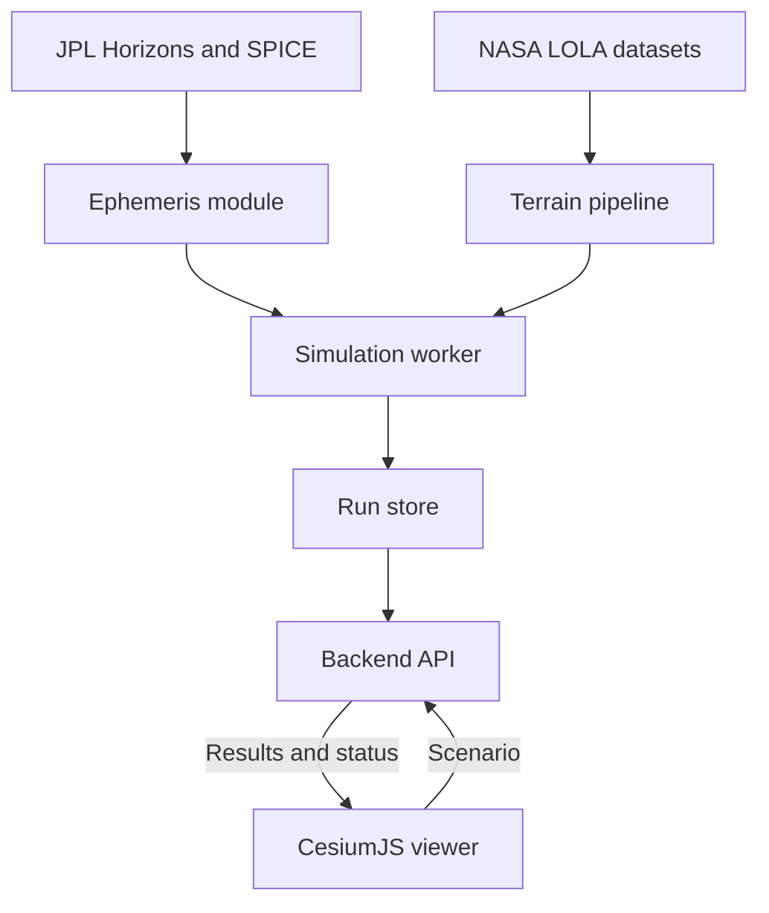

# LunaSight Studio · Technical context and research handoff

**Project:** 2026 NASA Space Apps Challenge, Lunar Landing Site Navigator  
**Purpose:** Paste this entire document into a new chat. It contains the project scope, technical decisions, candidate formulas, and open research questions. The last section tells the assistant how to use this context.

## Standing project instructions and decision status

- **Use real science inputs.** The demo’s Sun and Earth positions come from NASA JPL Horizons. The backend applies the lunar frame and time conventions using NAIF SPICE. Use NASA or another authoritative scientific archive for terrain and map layers, with product-level attribution and provenance.
- **Keep the product focused on comparing landing sites.** Pick a site center and radius, simulate the full area over a date range, and compare two sites. For Earth visibility, use a center mast first and use the same hypothetical mast height for any site-wide map.
- **Keep the simulation on the backend.** The server owns the scientific 3D geometry, ephemerides and results. CesiumJS is the preferred visualization engine. Its built-in astronomy and camera-dependent terrain detail do not drive the scientific results.
- **Report direct illumination and geometric Earth visibility.** Electrical engineering is outside this project scope. Solar siting uses irradiance and incident energy. Earth siting uses terrain line of sight and visibility windows.
- **Aim for reproducibility and explain the limits.** Keep measured inputs, derived data, modeled outputs and unresolved coverage distinguishable. State assumptions, test edge cases, and quantify sensitivity where the data and prototype allow. Keep planning organized by features, components and dependencies so the team can assign the work later.

The product scope, NASA-source requirement and backend/viewport boundary are agreed. The stack beyond the preferred CesiumJS viewer, demonstration settings, solver strategy and numerical tolerances are starting proposals. Section 4 records the checks already run. Sections 8 and 9 cover the tests and choices that are open.

## 1. What we are building

LunaSight Studio is a browser-based tool for comparing landing sites near the lunar south pole. NASA’s challenge asks for a usable way to compare how sunlight and the view of Earth change with location and date. We are building a terrain-aware simulation with a 3D viewer, a time slider, scientific map overlays, and side-by-side comparison. Users include mission-planning teams, educators, and the public. [NASA Space Apps challenge brief](https://www.spaceappschallenge.org/2026/challenges/lunar-landing-site-navigator/)

1. The user chooses a predefined site or clicks a location on the Moon, then chooses a radius and a UTC start and end. The radius defines a geodesic circular **reporting footprint**. Terrain outside it still affects the result.
2. The backend evaluates sunlight across the footprint. At each time it maps full sunlight, partial sunlight, shadow, and unresolved cells. It reports lit area, incident irradiance, daily summaries, and cumulative incident energy. The backend also evaluates Earth visibility from the site center at a fixed observer height above the terrain.
3. The browser displays the Moon, Sun and Earth directions, overlays, and a timeline. The user can play or scrub the timeline and inspect what changes. A local sky view can show the Sun and Earth disks against the terrain horizon. Optional diagnostic rays can end at the ridge that blocks them.
4. The user selects a second site. Compare the two using the same interval, units, grid policy, observation heights and thresholds by default. Also allow the same site to be compared at different dates. Label any changed settings. Use the same legend and colour scale across comparable views.

**First working demo.** A single site and timestamp, then one site over time, then two sites on a shared timeline. The core outputs are a sunlight map and direct incident energy across the site, and geometric Earth-visibility windows at its center mast. Demo settings to benchmark are Connecting Ridge and Shackleton Rim, 500 m radius, a 20 m reporting grid, and a 2 m center mast. Start with a short interval and expand to 1 January–1 February 2028. These settings are proposals.

**Expansion.** For each cell, evaluate Earth visibility from the same hypothetical mast height. Produce a map of visibility time and longest obstruction, and report the site area with a view of Earth at any time. Rank antenna locations by time visible, outage length, and horizon clearance. Rank solar locations using accumulated energy for a common reference collector at a specified height and orientation. Show a candidate area or ties if resolution and uncertainty do not support picking a single point. Slope and usable area can be additional filters. Add time-varying ray diagnostics, resource overlays, and a local sky or orbital view as time permits.

**Scope boundary.** The current workflow uses site selection and assumed observer heights. Equipment placement, panel electrical output, batteries, named Earth stations, relay satellites, link budgets, diffraction and throughput are out of scope. Earth visibility is a geometric screening result. Incident solar energy measures energy reaching a defined surface.

## 2. Architecture and data flow



| Component | Responsibility |
|---|---|
| Browser · CesiumJS and TypeScript | Stream lunar display tiles, pick sites, draw footprints, display provenance, render backend maps and diagnostics, and synchronize A/B playback. |
| API and jobs · Python/FastAPI candidate | Validate extent and date coverage, start or reuse a run, support progress and failures, and serve results by run ID and timestamp. Keep provider network calls server-side. |
| Ephemeris · JPL Horizons and SpiceyPy | Fetch and archive real Sun/Earth data. Align frame, epoch, units and correction convention. Supply common samples or interpolants for science and display. |
| Terrain intake · GDAL/Rasterio candidate | Ingest raw heights, georeferencing, counts, uncertainty and masks. Prepare a consistent multiresolution, Moon-fixed 3D world. Publish a terrain revision. |
| Science worker · Python/NumPy first | Clip the reporting grid, find the terrain horizon or trace rays, integrate finite-disk visibility and irradiance, refine events, and aggregate the outputs. Benchmark before introducing compiled acceleration or GPU compute. |
| Backend storage | Keep raw data and receipts, kernels, aligned heights, exact scientific 3D terrain or the deterministic representation needed to reproduce it, spatial indices, horizon caches, processed ephemerides and run outputs. Files and lightweight run metadata are enough to start. |

**Example API contract.** `POST /runs` takes lunar center, radius in metres, UTC start/end, mast height and an optional solver profile. Return run ID and normalized parameters. `GET /runs/{id}` serves status and summary. Add separate endpoints or static files for ephemerides, time-indexed maps, event windows and provenance. Use explicit CRS, local or Moon-fixed XYZ axes, units, timestamp and layer semantics. Backend owns canonical coordinates and scientific heights even if the UI estimates a cursor height from display tiles.

**Reproducibility.** Store source URLs or product IDs, versions, processing parameters and checksums. Store geospatial transforms, the kernel IDs and date coverage, raw Horizons request and headers, correction/epoch policy, sample spacing, thresholds, algorithm revision and validity flags. Cache terrain and ephemerides independently. A date change can reuse terrain horizons, and a change of terrain, observer position/height or horizon resolution can require a new horizon. Serve precomputed display slices independently of dense solver data. Scrubbing should not call Horizons or launch a full simulation.

**Suggested first repository layout.** Keep the web viewer and backend separate. Within the backend separate ingestion, ephemerides, terrain and visibility tests. Keep small manifests, test fixtures and scripts under version control. Use server-side `DATA/raw`, `DATA/processed`, `DATA/cache` and `DATA/runs` for downloaded archives, the scientific world, reusable intermediate data and run exports. Start with GeoTIFF or COG for terrain and figure-ready scientific rasters, JSON or CSV for small time series, and compact georeferenced map slices for playback. Pick final storage formats after measuring actual data size and browser loading time.

## 3. Authoritative inputs and browser rendering

| Input | Use and limits |
|---|---|
| [JPL Horizons API](https://ssd-api.jpl.nasa.gov/doc/horizons.html) and [system manual](https://ssd.jpl.nasa.gov/horizons/manual.html) | Sun/Earth states, local apparent azimuth/elevation, angular diameters and range. Archive the service header. This is the source for the prototype's Sun and Earth motion. |
| [NASA NAIF SPICE kernels](https://naif.jpl.nasa.gov/naif/data_generic.html) and [lunar frames guide](https://naif.jpl.nasa.gov/pub/naif/toolkit_docs/Tutorials/pdf/individual_docs/23_lunar-earth_pck-fk.pdf) | Lunar orientation and coordinate transformations, precise time handling, and optional local ephemeris evaluation at dense or adaptive epochs. |
| [NASA Goddard 5 m LOLA site DEMs](https://pgda.gsfc.nasa.gov/data/LOLA_5mpp/) and [broader polar DEMs](https://pgda.gsfc.nasa.gov/products/90) | Local measurement-derived terrain and regional occluders. Site01 is Connecting Ridge and Site04 is Shackleton Rim. Use counts, elevation uncertainty and available terrain realizations for sensitivity checks. Grid spacing and independently measured detail are different. |
| [NASA polar illumination products](https://pgda.gsfc.nasa.gov/products/69) and [Barker et al.](https://doi.org/10.1016/j.pss.2020.105119) | Benchmarks and context. Compare under the same terrain, observer height, epoch and metric definition where possible. A long-term illumination average is a different quantity from a forecast for January 2028. |
| [LROC QuickMap](https://quickmap.lroc.asu.edu/), [NASA Moon Trek](https://trek.nasa.gov/moon/) and [LROC PDS archive](https://pds.lroc.im-ldi.com/) | Site discovery, observed imagery and optional stereo-derived terrain where a documented digital terrain model (DTM) is available. Use the upstream product and metadata for analysis. |
| [Surface ice evidence from Chandrayaan-1 M³](https://pmc.ncbi.nlm.nih.gov/articles/PMC6130389/), [LRO Diviner](https://pds-geosciences.wustl.edu/missions/lro/diviner.htm), [LRO LEND](https://pds-geosciences.wustl.edu/missions/lro/lend.htm), [LCROSS](https://pubmed.ncbi.nlm.nih.gov/20966242/) | Bonus layers. Show the area of mapped detections and source coverage separately. Cold traps, hydrogen measurements, surface ice detections and the Cabeus impact result are distinct evidence. An ice mass estimate would require quantities such as depth, concentration and density that these layers alone do not supply. |

**CesiumJS is the preferred viewer.** Cesium Moon gives useful streamed 3D Tiles and a globally navigable Moon. Hide the built-in Sun in the science view and draw Sun/Earth disks or markers from the server’s vectors and angular sizes. A custom `DirectionalLight` points **from the Sun toward the surface**, opposite the site-to-Sun unit vector. Drive it from the same data as the marker. Use the backend’s finite-disk result as the authoritative shadow overlay. GPU shadows can add visual depth and depend on tile detail, materials and shadow-map settings. Keep observation-time shadows in orbital imagery distinguishable from simulated shadows. If a close-up view needs a relightable surface, test an aligned neutral-material local terrain mesh. For a sky or orbit inset label any exaggerated size or distance. Three.js with NASA-AMMOS is a fallback if a viewer requirement remains unmet. The browser lighting path does not change the science solver. [Cesium Moon](https://cesium.com/platform/cesium-ion/content/cesium-moon/) · [DirectionalLight](https://cesium.com/learn/cesiumjs/ref-doc/DirectionalLight.html) · [NASA-AMMOS 3D Tiles renderer](https://github.com/NASA-AMMOS/3DTilesRendererJS)

## 4. Horizons, SPICE and coordinate formulas

**Candidate query fixtures.** Use the JPL API endpoint `https://ssd.jpl.nasa.gov/api/horizons.api`. For a rendering/geometry table, request the body relative to the center of the Moon. For a validation table, ask for the apparent view from an exact lunar point. The lines below are parameter sets, not complete URLs.

```text
Common: COMMAND=10 (Sun) or COMMAND=399 (Earth), CSV_FORMAT=YES
Vectors: EPHEM_TYPE=VECTORS, CENTER=500@301, REF_SYSTEM=ICRF,
         REF_PLANE=FRAME, OUT_UNITS=KM-S, VEC_TABLE=2, TIME_TYPE=TDB,
         VEC_CORR=NONE (geometric) or LT+S (apparent-direction baseline)
Observer: EPHEM_TYPE=OBSERVER, CENTER=coord@301, COORD_TYPE=GEODETIC,
          SITE_COORD=0,-89.9,0, TIME_TYPE=UT, APPARENT=AIRLESS,
          QUANTITIES=4,13,20, ELEV_CUT=-90
Interval: START_TIME, STOP_TIME, STEP_SIZE, or TLIST for selected epochs
```

`SITE_COORD` is east longitude in degrees, latitude in degrees, and height in kilometres above Horizons’ reference surface. The example uses 89.9° S, 0° E at reference height. Quantities 4, 13 and 20 are apparent azimuth/elevation, angular diameter, and observer range/range rate. Check returned time and angle units, the reference surface, and ephemeris labels. Parse errors and `$$SOE` / `$$EOE` boundaries. Use one request at a time, a project-specific User-Agent with contact information, cache results, and back off on errors. Confirm supported dates using the intersection of service output, kernel coverage and the adopted high-accuracy frame. [Horizons API](https://ssd-api.jpl.nasa.gov/doc/horizons.html) · [Horizons manual](https://ssd.jpl.nasa.gov/horizons/manual.html) · [JPL API fair use](https://ssd-api.jpl.nasa.gov/doc/index.php)

**Frames and time.** The NASA site DEMs are in the DE421 lunar Mean Earth frame and a product-specific polar stereographic projection. Invert the actual product CRS. Preserve height datum, positive-east longitude and unit conversions. Use the applicable versioned NAIF frame/kernel pair, such as the DE440 `MOON_ME_DE440_ME421` frame aligned closely to DE421, and verify the remaining registration error. `REF_PLANE=BODY EQUATOR` gives an equator-and-node-of-date basis and is not a substitute for a Moon-fixed longitude frame. Convert displayed UTC to a consistent ephemeris time (TDB/ET) with pinned leap-second data. Keep the frame and aberration correction explicit. For higher precision, evaluate a site-specific apparent vector with a topocentric Horizons query or SPICE `spkcpo`; translating a Moon-center apparent vector is an approximation that can be benchmarked. For dense runs, local SPICE is a candidate, with recorded Horizons results still used as project data and as cross-checks. The prior local test used `de440s.bsp`, `moon_pa_de440_200625.bpc`, `moon_de440_250416.tf` and `naif0012.tls`. Treat these as a tested fixture and verify the kernel coverage and time data for any production interval. [NAIF frames](https://naif.jpl.nasa.gov/pub/naif/toolkit_docs/Tutorials/pdf/individual_docs/23_lunar-earth_pck-fk.pdf) · [SPKCPO](https://naif.jpl.nasa.gov/pub/naif/toolkit_docs/C/cspice/spkcpo_c.html)

**3D positions and local angles.** For a spherical reference product, let the radius be `R`, height be `h`, latitude be `φ`, and east longitude be `λ`. Use a matching ellipsoid conversion if the specified datum requires it. In the spherical approximation, `h` is radial. A mast height is then an additional local vertical offset above the sampled terrain.

```text
up      = (cos φ cos λ, cos φ sin λ, sin φ)
east    = (-sin λ, cos λ, 0)
north   = cross(up, east)
x_site  = (R + h) * up
x_mast  = x_site + mast_height * up

r_body_MF(t) = R_ICRF_to_MF(t) * r_body_ICRF(t)
v(x,t)       = r_body_MF(t) - x
d(x,t)       = v / norm(v)

azimuth   = atan2(dot(d,east), dot(d,north)) wrapped to [0, 2π)
elevation = atan2(dot(d,up), hypot(dot(d,east), dot(d,north)))
rho       = asin(R_body / norm(v))   # Angular radius for a spherical target
```

If Horizons supplies the angular diameter, `rho = diameter / 2` after unit conversion. Use the terrain normal for irradiance and radial up for sky angles. Choose a documented reference direction at the exact pole and handle azimuth wrap and undefined azimuth near zenith. Interpolate time-tagged Cartesian positions or unit vectors and renormalize directions. Validate interpolation at omitted epochs. Keep geometric, light-time-corrected and apparent results distinct, especially when computing contacts. [NAIF frame rotation](https://naif.jpl.nasa.gov/pub/naif/toolkit_docs/C/cspice/pxform_c.html) · [Horizons manual](https://ssd.jpl.nasa.gov/horizons/manual.html)

**Verified ephemeris checks.** On 32 daily samples from 1 January to 1 February 2028 at 89.9° S, 0° E, a Horizons DE441 Moon-center Sun vector converted with NAIF orientation and shifted to the observer agreed with a separate Horizons topocentric query to about 0.00005 arcseconds maximum for the tested setup. A separate local DE440 SPICE check gave approximately 0.002 arcseconds maximum for Earth at the same samples. In the Horizons observer table, the Sun’s center ranged from about −0.28° to +0.56° relative to local horizontal and the solar angular radius was about 0.27°. The Earth center elevations in the Horizons observer table spanned about −6.98° to +6.64°, and its apparent angular radius spanned roughly 0.90° to 1.02°. These are coordinate and sampling checks at one test point. The visible terrain horizon, event timing and browser alignment still need end-to-end tests.

**Verified inputs and viewer capability.** The Connecting Ridge and Shackleton Rim surface GeoTIFFs were downloaded and inspected. Both were 3,200 by 3,200 at 5 m grid spacing on the selected polar stereographic projection. NASA’s study notes that roughly 90% of its fine polar grid cells are interpolated. CesiumJS 1.147 source was inspected and its shadow-map update uses the custom scene light direction when supplied. The selected lunar tiles and a time-varying light still need a rendering test in the integrated viewer. [NASA terrain product notes](https://pgda.gsfc.nasa.gov/products/78) · [CesiumJS 1.147 scene source](https://github.com/CesiumGS/cesium/blob/1.147/packages/engine/Source/Scene/Scene.js)

## 5. Footprint, terrain and visibility geometry

**Footprint and grid.** On a spherical Moon, the distance from the site center to a candidate direction is `d_geo = R * atan2(norm(cross(u_center,u)), dot(u_center,u))`, where both vectors are unit radial directions. Use `d_geo <= radius` to define the reporting area, or a consistent geodesic on an adopted ellipsoid. Lay out a square grid in lunar polar stereographic coordinates. Compute each cell's footprint overlap area `a_i` in physical units on the reference surface. Correct for projection area if material to the metric. Use terrain surface area only when reporting energy on the actual sloped terrain. A 20 m reporting grid makes no change to the resolution of the source terrain. Refine sample locations near strong gradients, boundaries and high-scoring candidates. A cell can use several spatial quadrature samples.

**Scientific terrain.** Use full 3D, Moon-centered Moon-fixed XYZ geometry. Combine fine local terrain with broader context and a justified curvature-aware far-field cutoff or global background. NASA has documented shadows from mountains 120 km away. This example illustrates the need for far-field coverage. Choose the cutoff from terrain bounds and benchmarks. Verify coverage along possible sight lines, stitch overlapping representations without openings or double occluders, and propagate unresolved data. Never fill a missing occluding ridge with an assumption of clear sky. Use triangles with a BVH, or a gridded heightfield traversal with multiresolution bounds. For terrain samples exactly at the surface, offset the ray origin or exclude the source facet with a documented tolerance and test its effect. Get the outward terrain normal from the local 3D surface or a fitted normal estimator. [NASA polar shadow visualization](https://science.nasa.gov/resource/shadows-near-the-moons-south-pole/) · [NAIF shape models and ray intercepts](https://naif.jpl.nasa.gov/pub/naif/toolkit_docs/C/req/dsk.html)

**Ray test.** A line from an observer at `x` in unit direction `d` is `p(s) = x + s*d`. For a target at known range, test for hits between a small positive origin tolerance and the target. A direction is clear if terrain coverage is adequate and no terrain or lunar limb intercepts it. Keep three outcomes: clear, blocked and unresolved. Use hit position and blocking distance as optional diagnostics.

**Cached horizon alternative.** For each observer and azimuth `a`, compute `H_x(a)`, the maximum terrain-obstruction angle in that vertical plane from the curved 3D surface. The angle of a candidate point follows the elevation formula in §4 with direction proportional to its offset from the observer. For a distant source, a direction is clear when `el > H_x(az)`. Treat near-equality as a contact or uncertainty case. Compute profiles with multiresolution terrain, preserve narrow ridge peaks, and handle wrap at 0/360°. Binned samples alone give no guarantee that the largest obstruction was found. Use conservative angular bounds if available, nearby-bin refinement and targeted ray checks near contacts. A clear or blocked bound on the whole solar disk can skip detailed sampling. Cache by terrain revision, observer coordinates and height, horizon settings and solver version. Compare the horizon solution to direct rays and keep a full-ray reference for tests. Raster viewsheds or GPU shadow projection can support benchmarks for the appropriate geometry, while a photorealistic path tracer is unnecessary for first-pass direct sunlight. [Mazarico et al.](https://doi.org/10.1016/j.icarus.2010.10.030) · [Tong et al.](https://doi.org/10.1016/j.icarus.2022.115302)

## 6. Finite Sun, shadows and solar energy

Two types of partial shadow matter. A ridge can hide part of the apparent solar disk from a single point, producing a penumbra. Across a reporting cell, different points can have different visibility because a moving shadow edge crosses that cell. Angular refinement addresses the first and spatial refinement addresses the second. Use the finite Sun disk, local terrain slope and Earth eclipse mask. A solar center ray is a baseline or a diagnostic.

**Direct irradiance.** The following equations specify candidate numerical models. Angles in trig are in radians. Let `omega` be a unit direction from the surface toward a point on the Sun and `n` the receiving surface normal. Let `L(omega,t)` be apparent bolometric radiance, `V_T` the terrain-clear mask and `V_E` the Earth-eclipse-clear mask. Integrate over the apparent disk's solid angle.

```text
S(t) = S_1AU * (1 AU / Sun_range(t))^2

G_dir(x,t) = ∫ over Sun disk [
    L(omega,t) * V_T(x,omega) * V_E(x,omega,t) * max(0, dot(n,omega))
] dΩ                                              # W/m²

f_solar_disk(x,t) = ∫_disk V_T * V_E dΩ / ∫_disk dΩ  # geometric fraction
```

For a quadrature, use directions `omega_j`, solid-angle weights `w_j` and radiance shape weights `L_j` (uniform initially). Calibrate the unoccluded disk to irradiance `S(t)` on a plane normal to its center direction `d_sun`. This avoids labeling obscured disk fraction as power.

```text
G_dir ≈ S(t) * Σ_j [w_j L_j V_T,j V_E,j max(0, dot(n,omega_j))]
               / Σ_j [w_j L_j dot(d_sun,omega_j)]
```

Use about 1361 W/m² at 1 AU as a documented reference assumption. Solar variability or limb darkening can be added if sensitivity and credible inputs justify it. Example: an unobscured 1° Sun gives around 24 W/m² on a horizontal plane in the point-Sun approximation at 1 AU. A plane facing the Sun receives much more. Clearly state whether a map uses the local terrain tangent, horizontal, or a reference collector orientation. [NASA TSIS solar irradiance](https://earth.gsfc.nasa.gov/climate/projects/solar-irradiance/science) · [Finite-disk horizon modeling](https://doi.org/10.1016/j.icarus.2022.115302)

**Eclipses and other light.** For a spherical apparent Earth, compute center separation using `atan2(norm(cross(d_sun,d_earth)), dot(d_sun,d_earth))`. The disks never overlap when separation exceeds the sum of angular radii. During overlap set `V_E=0` for Sun samples inside the Earth limb. For higher fidelity, use the apparent limb of an Earth ellipsoid and consistent epoch corrections. Apply both masks to each ray so the same disk region is never subtracted twice. A published eclipse calendar provides an event check, and local eclipse contacts depend on the observer. The NASA-catalogued 12 January 2028 partial lunar eclipse is a test case. A prior diagnostic used 5-minute Horizons samples at 89.9° S, 0° E and detected solar-disk overlap near the catalogued event using a circular-limb model. The month-long daily samples missed the eclipse period, which is why contacts need a finer scan. The lunar exosphere has negligible refraction for this application. Refraction through the Earth's atmosphere, Earthshine and regolith reflection can contribute faint light, so report **zero direct sunlight** when the direct model yields zero. Secondary flux is future work. [NASA 2028 eclipses](https://eclipse.gsfc.nasa.gov/OH/OH2028.html) · [Lunar exosphere](https://science.nasa.gov/moon/lunar-atmosphere/) · [Earthshine and ShadowCam](https://www.nasa.gov/solar-system/nasas-shadowcam-images-lunar-south-pole-region/)

**Define the reported quantities.** Use a declared illumination threshold, in W/m² or visible disk fraction, and keep the definition in the run manifest. A cell's fractional lit area can be estimated from several subcell samples. For a simple first pass use one sample per cell. Below, `I_i(t)` is 0/1 for a thresholded point or the fraction of lit ground within a sampled cell.

```text
lit_site_fraction(t) = Σ_i a_i * I_i(t) / Σ_i a_i
cell_sunlit_fraction = ∫ I_i(t) dt / T
cell_energy_kWh_m2  = ∫ G_dir,i(t) dt_seconds / 3,600,000
site_mean_energy    = Σ_i a_i * cell_energy_i / Σ_i a_i
site_area_time_lit  = ∫ lit_site_fraction(t) dt / T
```

These formulas assume complete coverage and a common time interval of duration `T`. If data are missing, report valid area and time separately. If showing a lower and upper site lit fraction, known lit area divided by total area is the lower bound, and adding unresolved area to the numerator yields the upper bound. State the denominator when displaying a valid-only mean. Integrate irradiance using actual elapsed time and refine intervals around transitions. Daily rollups are derived from the underlying time series and should be weighted by the duration covered on each day. Report longest continuous darkness at representative points or for a stated site-wide threshold, with the observation level visible in the UI. The area-weighted mean above describes a field averaged over the footprint. A total incident-energy estimate on real facets uses each facet's true receiving area and corresponding irradiance. Current outputs describe incident energy.

## 7. Earth visibility and candidate antenna locations

At the center, use the DEM height plus the stated mast height. Compute topocentric Earth positions from real ephemerides. Evaluate the Moon's curved terrain, local ridges and lunar libration through that geometry. A center ray gives a binary result for a declared point target. Rays across the finite Earth disk give partial visibility. Start with the apparent angular diameter from Horizons or a spherical angular-radius model, and consider an ellipsoidal limb when warranted. The difference between the site-to-Earth direction and the Moon-center direction is important near the horizon.

```text
margin(x,t)          = Earth_center_elevation - H_x(Earth_center_azimuth)
Earth_center_visible = 1 if margin > 0, else 0    # only when terrain is resolved
Earth_disk_fraction  = Σ_k w_k * V_T(x,omega_k) / Σ_k w_k
visible_time_fraction = sum(duration of visible windows) / run_duration
```

Report windows, percentage of time visible, longest obstruction and clearance. Keep Earth disk fraction as a separate quantity. Positive visible area of the Earth disk indicates geometric access to some surface directions. A confirmed link would require a particular receiving station and RF model. The bonus spatial map repeats the computation for a hypothetical mast at each location and can show both per-cell visibility time and instantaneous fraction of eligible site area. It does not describe a radio mast sending signals to other cells on the site. Report unresolved intervals with bounds or explicit coverage.

## 8. Time, performance and verification

- **Time resolution.** Sample ephemerides and events independently of display frame rate. Refine around eclipse and terrain contacts, short windows, tangent cases, and rapid changes in the horizon profile. A bracketed root solve can refine an Earth-center crossing of the signed margin. Endpoints with the same sign can still hide two crossings, so test adaptive interior samples or use conservative bounds and refine known high-risk intervals. A sunrise estimate based on center elevation ± solar radius can help bracket events for a locally flat horizon, but detailed angular sampling is needed near azimuth-dependent ridges.
- **Performance.** A 500 m radius on a 20 m grid yields about 2,000 cells. Approximately 744 hourly intervals in January and 16 disk samples would give roughly 23 million per-cell Sun visibility queries in a naive evaluation. Reuse horizons, batch vectors and rays, skip unambiguous disks, and profile the terrain preparation, cold runs, warm runs and playback separately. Study multiresolution profiles and a BVH before optimizing further. Browser rays can be sparse and illustrative even when the backend uses denser sampling.
- **Geometry fixtures.** On a flat plane and on a spherical surface, check angle conventions, incidence, horizon, tangencies and origin offsets against simple analytic setups. Use known-height ridges, azimuth seam cases, partially overlapped grid cells, terrain gaps, and a distant occluder.
- **Science verification.** Compare directions to Horizons at identical epochs, coordinates and height. Check frame registration against control points. Check finite-disk fraction for fully blocked, partially blocked and fully clear cases. Compare horizon and ray results near contacts, and check the eclipse against NASA while respecting the difference between local and global contacts. Compare longer-term LOLA-derived metrics to published NASA polar results only when their assumptions match.
- **Convergence and uncertainty.** Refine spatial spacing, azimuth bins, disk sampling and time step independently. Report changes in lit fraction, accumulated energy and visibility-window times. Check whether ranking survives changed terrain realizations or coverage. Distinguish numerical error, terrain uncertainty, and approximations such as a uniform solar disk. Display supported regions and dates. Establish tolerances after the team sets accuracy needs and measures achievable performance.

## 9. Work to plan and open research decisions

| Work package | Research question | Evidence needed before settling the design |
|---|---|---|
| Ephemeris and date support | What Horizons tables and dates are reliable? Which correction and frame should serve science and playback, and when is local SPICE preferable? | Working Sun/Earth query fixtures, raw headers, a date-coverage policy and direction residuals at known lunar sites. |
| Terrain ingest and publication | Which local and regional DEMs cover the prototype and its occluders? How should tiles be aligned, stitched and stored? | Source manifest, aligned scientific 3D patch, height/frame checks and missing-data treatment. |
| Visibility and irradiance | How much accuracy and runtime do we get from direct 3D rays, a cached horizon or a hybrid? How many samples resolve the penumbra? | Analytic and real-data fixtures, comparable errors and runtimes, scenario-specific limits. |
| Metrics and time integration | How should we define lit area, reference orientation, event tolerance, and uncertainty? | Explicit formulas and units, sensitivity plots, repeatable summaries. |
| CesiumJS viewer and outputs | Can the streamed tiles, matching data layers and custom lighting stay in sync at a common epoch? | Working timeline sample, verified lunar pick/overlay alignment, and a clear visual difference between imagery and simulated shadows. |
| Site comparison and expansion | Which summary cards and maps best support a decision? How can per-cell Earth view and candidate siting reuse the engine? | A/B scenario with shared settings, consistent thresholds, uncertain or tied rankings handled explicitly. |

**Build dependencies.** Lock a shared coordinate convention, a real test point and a time before joining components. Fetch raw Horizons and LOLA fixtures, test rotation and terrain alignment, and produce one scientific snapshot. Wire it to the browser. Then add a timeline and event/energy summaries, and finally the A/B comparison. Backend, viewer and solver experiments can run in parallel against the same fixture. Keep ownership open until the team reviews the work.

## 10. Instruction for the next chat

Act as a senior software, space, and systems engineer working with the LunaSight Studio team. Use this document as the project context. For the question below, start from the current site-comparison scope, cite primary sources for claims about data or software, and state which details are verified, proposed or still open. Explain the trade-offs and propose the smallest reproducible experiment, including inputs, outputs and acceptance checks. Keep work packages independent of personal assignment unless asked.

**Research question:** [Replace this line with the feature, formula, dataset or implementation decision we want to investigate.]
